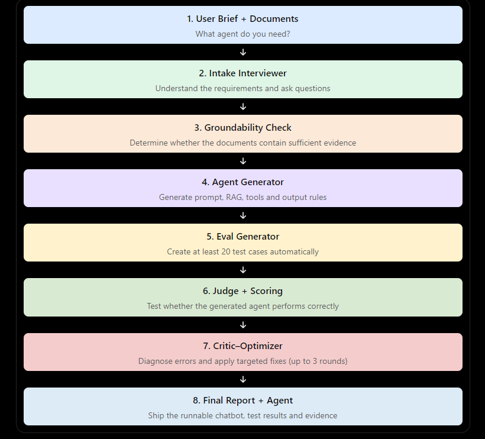

# ForgeAI

ForgeAI is a local-first prototype of a generic document-grounded AI agent factory. It takes a natural-language brief and a document folder, creates requirements and a declarative agent definition, ingests and retrieves source evidence, generates an evaluation suite from the supplied collection, runs a bounded optimization loop, and saves an honest report.

## Problem and design


The goal is to make it easier to build task-specific agents without hand-coding one application per domain. A generic pipeline handles HR, marine procurement, and new document collections. Generated agents must answer from evidence, cite real source files, and abstain when the collection does not support a response.

The CLI is the primary interface. Streamlit is a thin UI over the same workflow. See [ARCHITECTURE.md](./ARCHITECTURE.md), [PROJECT_PLAN.md](./PROJECT_PLAN.md), and [DECISIONS.md](./DECISIONS.md).

## Technology

- Python 3.11+, Pydantic 2, httpx, pytest, PyMuPDF, Streamlit.
- Lightweight lexical retrieval runs without downloading an embedding model.
- Optional Ollama provider uses the local `/api/chat` endpoint.
- No paid API key is required. `OPENAI_API_KEY` is not used.

## Setup

```powershell
py -3.11 -m venv .venv
.\.venv\Scripts\Activate.ps1
python -m pip install -r requirements.txt
```

ForgeAI reads configuration from environment variables and does not load `.env` files automatically. Set any needed variables in your shell or operating-system environment. Defaults use offline extractive mode. PDF extraction requires PyMuPDF, included in `requirements.txt`.

## Ollama (optional)

Ollama was not installed during environment inspection. If you install it yourself and choose a model that fits your available memory, pull that model through Ollama, then set:

```powershell
$env:FORGEAI_PROVIDER = "ollama"
$env:OLLAMA_MODEL = "your-installed-model"
```

ForgeAI does not download models or require cloud credentials. Ollama answers are not used by default. Model size, output, and quality depend on the operator's choice.

## CLI

From the project root:

```powershell
python -m forgeai.cli --help
python -m forgeai.cli build --brief "Create an HR policy assistant that answers from the handbook and refuses unsupported policy questions." --documents demos/hr_policy/documents
python -m forgeai.cli chat --agent artifacts/hr_policy_assistant/agent_definition.json
python -m forgeai.cli evaluate --agent artifacts/hr_policy_assistant/agent_definition.json --cases artifacts/hr_policy_assistant/evals/cases.json
python -m forgeai.cli tools --documents demos/marine_procurement/documents
```

Interactive intake is available with `--interactive`. Unattended intake records conservative assumptions. `--iterations` accepts 0–3.

## UI

```powershell
streamlit run app.py
```

The UI builds agents from uploaded documents, supports generic agent chat, and loads saved evaluation reports. Uploaded collections are saved under the ignored `.forgeai_uploads/` folder because generated agent definitions need a persistent source path.

## Demos

```powershell
python -m forgeai.cli build --brief "Create an HR policy assistant. Answer documented leave, attendance, benefits, remote work, travel and expense questions, and refuse unsupported questions." --documents demos/hr_policy/documents --top-k 1
python -m forgeai.cli build --brief "Create a marine ship-spares procurement assistant. Search the CSV catalogue, retrieve supplier information, compare available items, use catalogue lookup where useful, and refuse unsupported procurement claims." --documents demos/marine_procurement/documents
python -m forgeai.cli build --brief "Create a university materials laboratory safety assistant that answers only from the guide and refuses unsupported safety advice." --documents demos/generalization/documents
```

The first two create the required demos; the third is an independent generalization check. Synthetic source material, reproducible HR collection splitting, supplier PDF generation, all generation prompts, and the verified sample run artifacts are included. Outputs from additional runs are ignored by default.

## Tests

```powershell
python -m pytest -q
```

Tests use synthetic files and mocked weather HTTP calls. The suite does not claim a live model end-to-end run. The semantic judge is unit tested with a mocked response; no live Ollama run was available during verification.

## Workflow and scoring

Intake creates requirements and up to five clarifying questions. Evaluation generation is deterministic: prose and PDF cases come from qualifying sentences; CSV cases refer to named columns and actual rows. Evidence cases include exact chunk quotations and source/page/row references that are checked against ingested chunks. Limited comparison cases are added only when separate sections or documents share a specific subject. Numeric CSV comparisons are computed from cited operands and revalidated arithmetically. Refusal cases use explicit missing-information expectations and have separate counts. Ambiguity, conflicting evidence, and other categories appear only when the documents support them. A completed build requires at least 20 validated factual cases; insufficient content stops the build with diagnostics.

The deterministic judge reports semantic correctness (lexical proxy), evidence grounding, citation correctness, completeness, refusal correctness, and writing quality separately. Writing quality cannot raise the factual pass decision. LLM judging is opt-in with `FORGEAI_JUDGE_PROVIDER=ollama` and `FORGEAI_JUDGE_MODEL=<installed-model>`. It sees anonymized A/B answers in both orders; changes in decision are recorded. `evaluator_metadata` discloses when judge and generator use the same model. Without a configured evaluator, semantic judging is marked unavailable. These checks do not eliminate evaluator bias.

Optimization reuses the validated case IDs, evaluates settings changes on an optimization set, and keeps a candidate only when that set improves. When at least 25 factual cases exist, a stable one-in-five factual holdout is evaluated only after selection; it is not used to choose changes. Smaller suites disclose that no meaningful holdout was available. Each iteration records failed-case evidence, mismatch, classification, root cause, exact before/after settings, scores, regressions, and limits. The maximum is three iterations. Full per-case judge records are saved in `evaluation_results.json`.

## Folder structure

```text
forgeai/                 core package
forgeai/evaluation/      generation, judge, optimizer
forgeai/tools/           safe executable tools
demos/                   HR, procurement, and generalization source collections
prompts/                 committed evaluation prompt
tests/                   automated tests
scripts/                 synthetic PDF generation helper
artifacts/               generated, git-ignored reports and agent definitions
app.py                   Streamlit client
cli.py                   compatibility entry point
```

## Limitations

This is an assignment prototype, not a production HR/legal, procurement, or safety system. Retrieval is lexical and offline answers are evidence excerpts, not generated synthesis. Case construction uses conservative heuristics and comparison prompts may still be too broad; review category coverage and per-case records before relying on scores. Deterministic correctness uses lexical overlap, writing quality is a simple length/readability proxy, and no calibrated evaluator-bias study has been run. Holdout comparison is meaningful only for larger suites. The optimizer changes only a small set of prompt/retrieval settings. Weather requires internet access and is attached only when selected. See [KNOWN_LIMITATIONS.md](./KNOWN_LIMITATIONS.md).
